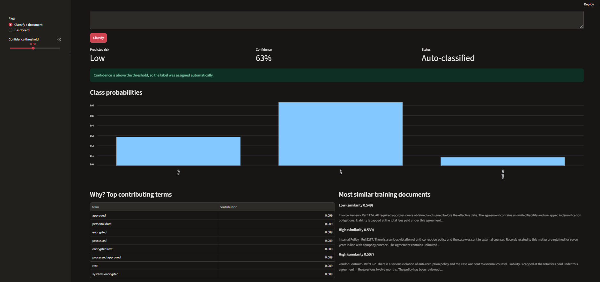
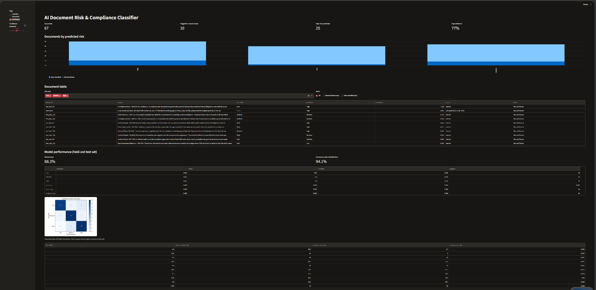
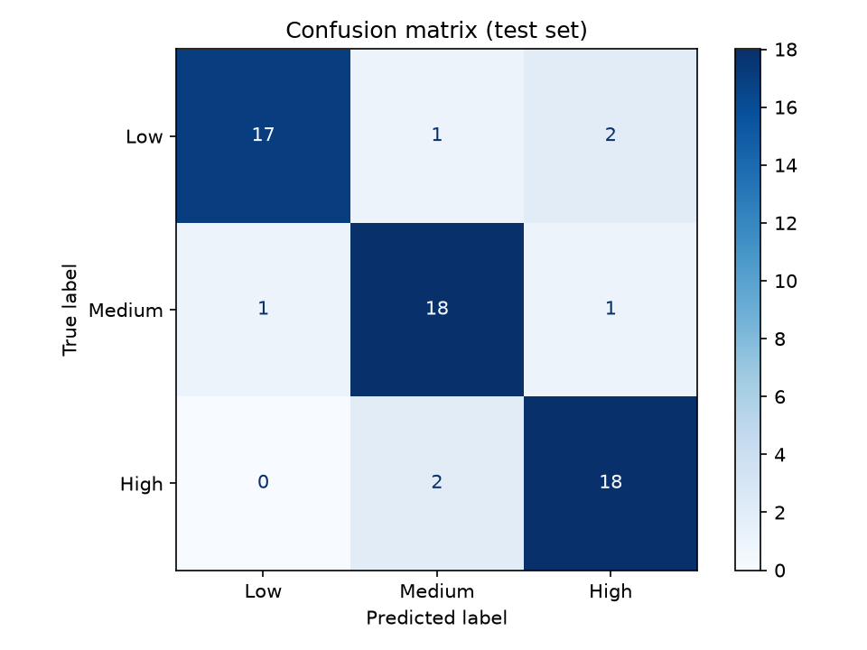

# AI Document Risk & Compliance Classifier

Classifies business documents as **Low / Medium / High** risk and sends low-confidence cases to **manual review**.

## Approach
1. **Data**: synthetic labelled documents (contracts, policies, incident reports, audits) generated by `generate_data.py`. Swap in real documents by replacing `data/labels.csv` (columns: `text`, `label`).
2. **Extraction & cleaning**: `extract.py` reads PDF (pypdf), DOCX (python-docx) and TXT; lowercases, strips page numbers and whitespace.
3. **Model**: TF-IDF (1-2 grams) + Logistic Regression (`train.py`), 80/20 stratified split, 5-fold CV.
4. **Explainability**: top contributing terms (TF-IDF x class coefficient) and the 3 most similar training documents (cosine similarity).
5. **Confidence threshold**: if max class probability < 0.6 the document is flagged **Manual Review** (adjustable in the app; trade-off in `reports/threshold_sweep.csv`).
6. **Dashboard**: Streamlit app with upload/classify page and a dashboard of flagged documents, class counts and model metrics.

## Run
```bash
pip install -r requirements.txt
python generate_data.py
python train.py
streamlit run app.py
```
Try the files in `samples/` in the app.

## Results
Fill in from the output of `python train.py` (also in `reports/metrics.json`):

| Metric | Value |
|---|---|
| Test accuracy |88.3% |
| 5-fold CV accuracy |81.7% |
| % sent to manual review (threshold 0.6) |15.0% |
| Accuracy on auto-classified docs |94.1% |

Confusion matrix: `reports/confusion_matrix.png`

## Limitations / future work
- Synthetic data is cleaner than real documents; retrain on real labelled data.
- Try sentence embeddings or fine-tuned transformers; add calibration of probabilities.
## Screenshots

### Classify page


### Dashboard


### Confusion matrix

